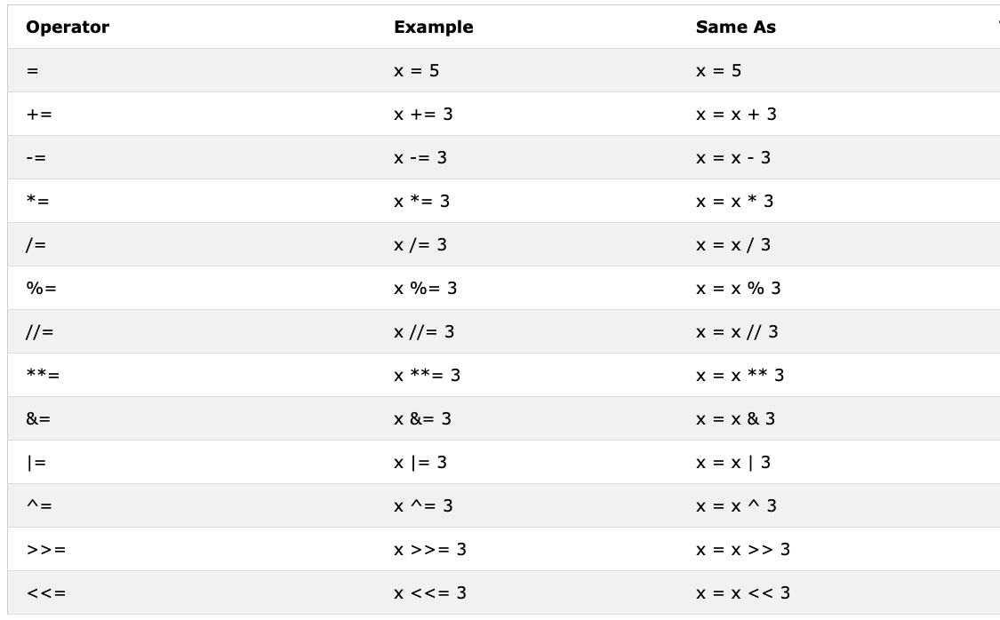
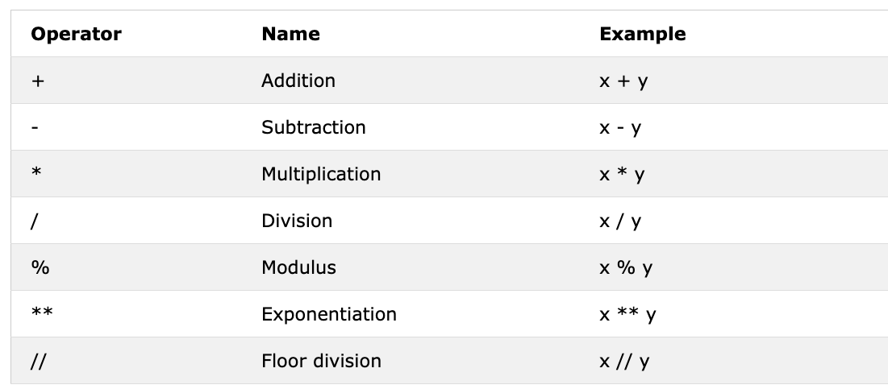
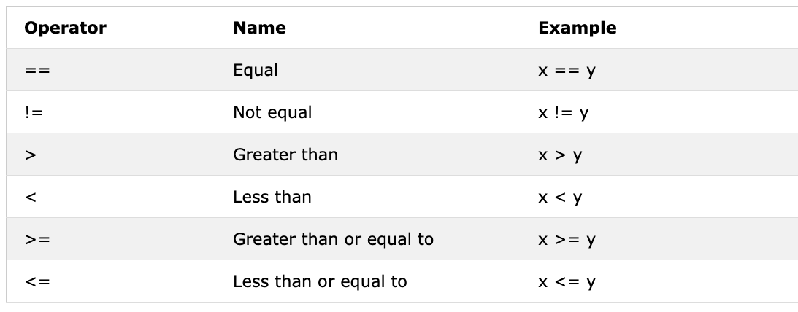
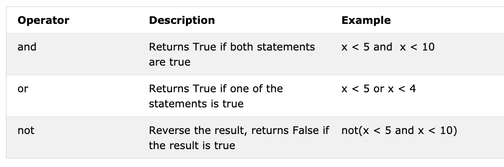

## Booléen

Un booléen est un type de données qui ne peut prendre que deux valeurs : _True_ (Vrai) ou _False_ (Faux). Leur utilité deviendra évidente quand nous commencerons à utiliser les opérateurs de comparaison. La première lettre **T** pour True et **F** pour False doit être en majuscule, contrairement à JavaScript.
**Exemple : Valeurs booléennes**

```py
print(True)
print(False)
```

## Opérateurs

Python propose plusieurs types d'opérateurs. Dans cette section, nous allons nous concentrer sur les principaux.

### Opérateurs d'affectation

Les opérateurs d'affectation servent à assigner des valeurs aux variables. Prenons le signe `=` comme exemple. En mathématiques, il indique une égalité entre deux valeurs, mais en Python, il signifie que l'on stocke une valeur dans une variable — on appelle cela une affectation. Le tableau ci-dessous présente les différents opérateurs d'affectation Python, tiré de [w3schools](https://www.w3schools.com/python/python_operators.asp).



### Opérateurs arithmétiques

- Addition(+) : a + b
- Soustraction(-) : a - b
- Multiplication(*) : a * b
- Division(/) : a / b
- Modulo(%) : a % b
- Division entière(//) : a // b
- Exponentiation(**) : a ** b



**Exemple : Entiers**

```py
# Arithmetic Operations in Python
# Integers

print('Addition: ', 1 + 2)        # 3
print('Subtraction: ', 2 - 1)     # 1
print('Multiplication: ', 2 * 3)  # 6
print ('Division: ', 4 / 2)       # 2.0  Division in Python gives floating number
print('Division: ', 6 / 2)        # 3.0         
print('Division: ', 7 / 2)        # 3.5
print('Division without the remainder: ', 7 // 2)   # 3,  gives without the floating number or without the remaining
print ('Division without the remainder: ',7 // 3)   # 2
print('Modulus: ', 3 % 2)         # 1, Gives the remainder
print('Exponentiation: ', 2 ** 3) # 8 it means 2 * 2 * 2
```

**Exemple : Flottants**

```py
# Floating numbers
print('Floating Point Number, PI', 3.14)
print('Floating Point Number, gravity', 9.81)
```

**Exemple : Nombres complexes**

```py
# Complex numbers
print('Complex number: ', 1 + 1j)
print('Multiplying complex numbers: ',(1 + 1j) * (1 - 1j))
```

Déclarons une variable et assignons-lui un type de données numérique. Je vais utiliser des noms de variables à un seul caractère, mais rappelez-vous de ne pas prendre l'habitude de déclarer ce genre de variables. Les noms de variables doivent toujours être explicites.

**Exemple :**

```python
# Declaring the variable at the top first

a = 3 # a is a variable name and 3 is an integer data type
b = 2 # b is a variable name and 3 is an integer data type

# Arithmetic operations and assigning the result to a variable
total = a + b
diff = a - b
product = a * b
division = a / b
remainder = a % b
floor_division = a // b
exponential = a ** b

# I should have used sum instead of total but sum is a built-in function - try to avoid overriding built-in functions
print(total) # if you do not label your print with some string, you never know where the result is coming from
print('a + b = ', total)
print('a - b = ', diff)
print('a * b = ', product)
print('a / b = ', division)
print('a % b = ', remainder)
print('a // b = ', floor_division)
print('a ** b = ', exponential)
```

**Exemple :**

```py
print('== Addition, Subtraction, Multiplication, Division, Modulus ==')

# Declaring values and organizing them together
num_one = 3
num_two = 4

# Arithmetic operations
total = num_one + num_two
diff = num_two - num_one
product = num_one * num_two
div = num_two / num_one
remainder = num_two % num_one

# Printing values with label
print('total: ', total)
print('difference: ', diff)
print('product: ', product)
print('division: ', div)
print('remainder: ', remainder)
```

Commençons à faire le lien et à utiliser ce que nous savons déjà pour calculer (aire, volume, densité, poids, périmètre, distance, force).

**Exemple :**

```py
# Calculating area of a circle
radius = 10                                 # radius of a circle
area_of_circle = 3.14 * radius ** 2         # two * sign means exponent or power
print('Area of a circle:', area_of_circle)

# Calculating area of a rectangle
length = 10
width = 20
area_of_rectangle = length * width
print('Area of rectangle:', area_of_rectangle)

# Calculating a weight of an object
mass = 75
gravity = 9.81
weight = mass * gravity
print(weight, 'N')                         # Adding unit to the weight

# Calculate the density of a liquid
mass = 75 # in Kg
volume = 0.075 # in cubic meter
density = mass / volume # 1000 Kg/m^3
print(density, 'Kg/m^3') # Adding unit to the density

```

### Opérateurs de comparaison

En programmation, nous comparons des valeurs à l'aide d'opérateurs de comparaison. Nous vérifions si une valeur est supérieure, inférieure ou égale à une autre. Le tableau suivant présente les opérateurs de comparaison Python, tiré de [w3schools](https://www.w3schools.com/python/python_operators.asp).


**Exemple : Opérateurs de comparaison**

```py
print(3 > 2)     # True, because 3 is greater than 2
print(3 >= 2)    # True, because 3 is greater than 2
print(3 < 2)     # False,  because 3 is greater than 2
print(2 < 3)     # True, because 2 is less than 3
print(2 <= 3)    # True, because 2 is less than 3
print(3 == 2)    # False, because 3 is not equal to 2
print(3 != 2)    # True, because 3 is not equal to 2
print(len('mango') == len('avocado'))  # False
print(len('mango') != len('avocado'))  # True
print(len('mango') < len('avocado'))   # True
print(len('milk') != len('meat'))      # False
print(len('milk') == len('meat'))      # True
print(len('tomato') == len('potato'))  # True
print(len('python') > len('dragon'))   # False


# Comparing something gives either a True or False

print('True == True: ', True == True)
print('True == False: ', True == False)
print('False == False:', False == False)
```

En plus des opérateurs de comparaison ci-dessus, Python utilise :

- _is_ : Renvoie True si les deux variables sont le même objet (x is y)
- _is not_ : Renvoie True si les deux variables ne sont pas le même objet (x is not y)
- _in_ : Renvoie True si la liste interrogée contient un certain élément (x in y)
- _not in_ : Renvoie True si la liste interrogée ne contient pas un certain élément (x not in y)

```py
print('1 is 1', 1 is 1)                   # True - because the data values are the same
print('1 is not 2', 1 is not 2)           # True - because 1 is not 2
print('A in Asabeneh', 'A' in 'Asabeneh') # True - A found in the string
print('B not in Asabeneh', 'B' in 'Asabeneh') # False - there is no uppercase B
print('coding' in 'coding for all') # True - because coding for all has the word coding
print('a in an:', 'a' in 'an')      # True
print('4 is 2 ** 2:', 4 is 2 ** 2)   # True
```

### Opérateurs logiques

Contrairement à d'autres langages de programmation, Python utilise les mots-clés _and_, _or_ et _not_ pour les opérateurs logiques. Les opérateurs logiques sont utilisés pour combiner des instructions conditionnelles :



```py
print(3 > 2 and 4 > 3) # True - because both statements are true
print(3 > 2 and 4 < 3) # False - because the second statement is false
print(3 < 2 and 4 < 3) # False - because both statements are false
print('True and True: ', True and True)
print(3 > 2 or 4 > 3)  # True - because both statements are true
print(3 > 2 or 4 < 3)  # True - because one of the statements is true
print(3 < 2 or 4 < 3)  # False - because both statements are false
print('True or False:', True or False)
print(not 3 > 2)     # False - because 3 > 2 is true, then not True gives False
print(not True)      # False - Negation, the not operator turns true to false
print(not False)     # True
print(not not True)  # True
print(not not False) # False

```

🌕 Vous avez une énergie débordante. Vous venez de terminer le défi du Jour 3 et vous êtes trois pas de plus sur la voie de la grandeur. Faites maintenant quelques exercices pour votre cerveau et vos muscles.

## 💻 Exercices - Jour 3

1. Déclarez votre âge comme une variable de type entier.
2. Déclarez votre taille comme une variable de type flottant.
3. Déclarez une variable qui stocke un nombre complexe.
4. Écrivez un script qui demande à l'utilisateur d'entrer la base et la hauteur d'un triangle et calcule l'aire de ce triangle (aire = 0,5 x b x h).

```py
    Enter base: 20
    Enter height: 10
    The area of the triangle is 100
```

5. Écrivez un script qui demande à l'utilisateur d'entrer le côté a, le côté b et le côté c d'un triangle. Calculez le périmètre du triangle (périmètre = a + b + c).

```py
Enter side a: 5
Enter side b: 4
Enter side c: 3
The perimeter of the triangle is 12
```

6. Obtenez la longueur et la largeur d'un rectangle à l'aide de la fonction input. Calculez son aire (aire = longueur x largeur) et son périmètre (périmètre = 2 x (longueur + largeur)).
7. Obtenez le rayon d'un cercle à l'aide de la fonction input. Calculez l'aire (aire = pi x r x r) et la circonférence (c = 2 x pi x r) où pi = 3,14.
8. Calculez la pente, l'ordonnée à l'origine et l'abscisse à l'origine de y = 2x - 2.
9. La pente est (m = y2-y1/x2-x1). Trouvez la pente et la [distance euclidienne](https://en.wikipedia.org/wiki/Euclidean_distance#:~:text=In%20mathematics%2C%20the%20Euclidean%20distance,being%20called%20the%20Pythagorean%20distance.) entre le point (2, 2) et le point (6, 10).
10. Comparez les pentes des tâches 8 et 9.
11. Calculez la valeur de y (y = x^2 + 6x + 9). Essayez différentes valeurs de x et déterminez à quelle valeur de x, y est égal à 0.
12. Trouvez la longueur de 'python' et 'dragon' et faites une déclaration de comparaison fausse.
13. Utilisez l'opérateur _and_ pour vérifier si 'on' se trouve à la fois dans 'python' et 'dragon'.
14. _I hope this course is not full of jargon_. Utilisez l'opérateur _in_ pour vérifier si _jargon_ est dans la phrase.
15. Il n'y a pas de 'on' dans dragon et python.
16. Trouvez la longueur du texte _python_ et convertissez la valeur en flottant, puis convertissez-la en chaîne de caractères.
17. Les nombres pairs sont divisibles par 2 et le reste est zéro. Comment vérifier si un nombre est pair ou non en Python ?
18. Vérifiez si la division entière de 7 par 3 est égale à la valeur convertie en entier de 2,7.
19. Vérifiez si le type de '10' est égal au type de 10.
20. Vérifiez si int('9.8') est égal à 10.
21. Écrivez un script qui demande à l'utilisateur d'entrer le nombre d'heures et le taux horaire. Calculez le salaire de la personne.

```py
Enter hours: 40
Enter rate per hour: 28
Your weekly earning is 1120
```

22. Écrivez un script qui demande à l'utilisateur d'entrer le nombre d'années vécues. Calculez le nombre de secondes qu'une personne peut vivre. Supposons qu'une personne peut vivre cent ans.

```py
Enter number of years you have lived: 100
You have lived for 3153600000 seconds.
```

23. Écrivez un script Python qui affiche le tableau suivant :

```py
1 1 1 1 1
2 1 2 4 8
3 1 3 9 27
4 1 4 16 64
5 1 5 25 125
```

🎉 FÉLICITATIONS ! 🎉
