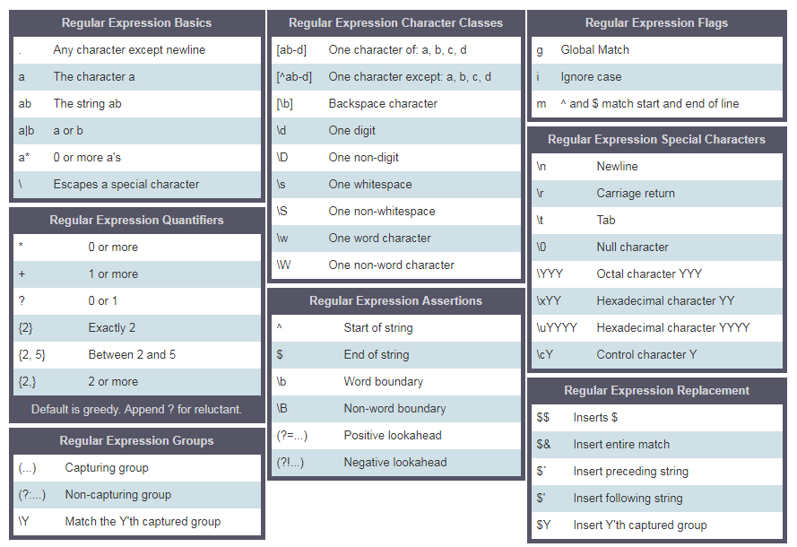

## Expressions régulières

Une expression régulière (RegEx) est une chaîne de texte spéciale qui aide à trouver des motifs dans les données. Une RegEx peut être utilisée pour vérifier si un motif existe dans un type de données différent. Pour utiliser RegEx en Python, nous devons d'abord importer le module RegEx appelé *re*.

### Le module *re*

Après avoir importé le module, nous pouvons l'utiliser pour détecter ou trouver des motifs.

```py
import re
```

### Méthodes du module *re*

Pour trouver un motif, nous utilisons différents ensembles de caractères *re* qui permettent de rechercher une correspondance dans une chaîne.

- *re.match()* : recherche uniquement au début de la première ligne de la chaîne et retourne les objets correspondants s'ils sont trouvés, sinon retourne None.
- *re.search* : retourne un objet match s'il y a une correspondance quelque part dans la chaîne, y compris dans les chaînes multilignes.
- *re.findall* : retourne une liste contenant toutes les correspondances.
- *re.split* : prend une chaîne, la divise aux points de correspondance, retourne une liste.
- *re.sub* : remplace une ou plusieurs correspondances dans une chaîne.

#### Match

```py
# syntax
re.match(substring, string, re.I)
# substring is a string or a pattern, string is the text we look for a pattern , re.I is case ignore
```

```py
import re

txt = 'I love to teach python and javaScript'
# It returns an object with span, and match
match = re.match('I love to teach', txt, re.I)
print(match)  # <re.Match object; span=(0, 15), match='I love to teach'>
# We can get the starting and ending position of the match as tuple using span
span = match.span()
print(span)     # (0, 15)
# Lets find the start and stop position from the span
start, end = span
print(start, end)  # 0 15
substring = txt[start:end]
print(substring)       # I love to teach
```

Comme vous pouvez le voir dans l'exemple ci-dessus, le motif que nous recherchons (ou la sous-chaîne que nous recherchons) est *I love to teach*. La fonction match retourne un objet **uniquement** si le texte commence par le motif.

```py
import re

txt = 'I love to teach python and javaScript'
match = re.match('I like to teach', txt, re.I)
print(match)  # None
```

La chaîne ne commence pas par *I like to teach*, donc il n'y a pas eu de correspondance et la méthode match a retourné None.

#### Search

```py
# syntax
re.search(substring, string, re.I)
# substring is a pattern, string is the text we look for a pattern , re.I is case ignore flag
```

```py
import re

txt = '''Python is the most beautiful language that a human being has ever created.
I recommend python for a first programming language'''

# It returns an object with span and match
match = re.search('first', txt, re.I)
print(match)  # <re.Match object; span=(100, 105), match='first'>
# We can get the starting and ending position of the match as tuple using span
span = match.span()
print(span)     # (100, 105)
# Lets find the start and stop position from the span
start, end = span
print(start, end)  # 100 105
substring = txt[start:end]
print(substring)       # first
```

Comme vous pouvez le voir, search est bien meilleur que match car il peut chercher le motif dans tout le texte. Search retourne un objet match avec la première correspondance trouvée, sinon il retourne *None*. Une fonction *re* bien meilleure est *findall*. Cette fonction vérifie le motif dans toute la chaîne et retourne toutes les correspondances sous forme de liste.

#### Rechercher toutes les correspondances avec *findall*

*findall()* retourne toutes les correspondances sous forme de liste.

```py
txt = '''Python is the most beautiful language that a human being has ever created.
I recommend python for a first programming language'''

# It return a list
matches = re.findall('language', txt, re.I)
print(matches)  # ['language', 'language']
```

Comme vous pouvez le voir, le mot *language* a été trouvé deux fois dans la chaîne. Pratiquons un peu plus.
Maintenant, cherchons à la fois les mots Python et python dans la chaîne :

```py
txt = '''Python is the most beautiful language that a human being has ever created.
I recommend python for a first programming language'''

# It returns list
matches = re.findall('python', txt, re.I)
print(matches)  # ['Python', 'python']

```

Puisque nous utilisons *re.I*, les lettres minuscules et majuscules sont incluses. Si nous n'avons pas le drapeau re.I, nous devrons écrire notre motif différemment. Vérifions cela :

```py
txt = '''Python is the most beautiful language that a human being has ever created.
I recommend python for a first programming language'''

matches = re.findall('Python|python', txt)
print(matches)  # ['Python', 'python']

#
matches = re.findall('[Pp]ython', txt)
print(matches)  # ['Python', 'python']

```

#### Remplacer une sous-chaîne

```py
txt = '''Python is the most beautiful language that a human being has ever created.
I recommend python for a first programming language'''

match_replaced = re.sub('Python|python', 'JavaScript', txt, re.I)
print(match_replaced)  # JavaScript is the most beautiful language that a human being has ever created.I recommend python for a first programming language
# OR
match_replaced = re.sub('[Pp]ython', 'JavaScript', txt, re.I)
print(match_replaced)  # JavaScript is the most beautiful language that a human being has ever created.I recommend python for a first programming language
```

Ajoutons un exemple supplémentaire. La chaîne suivante est vraiment difficile à lire à moins de supprimer le symbole %. Remplacer % par une chaîne vide nettoiera le texte.

```py

txt = '''%I a%m te%%a%%che%r% a%n%d %% I l%o%ve te%ach%ing.
T%he%re i%s n%o%th%ing as r%ewarding a%s e%duc%at%i%ng a%n%d e%m%p%ow%er%ing p%e%o%ple.
I fo%und te%a%ching m%ore i%n%t%er%%es%ting t%h%an any other %jobs.
D%o%es thi%s m%ot%iv%a%te %y%o%u to b%e a t%e%a%cher?'''

matches = re.sub('%', '', txt)
print(matches)
```

```sh
I am teacher and I love teaching.
There is nothing as rewarding as educating and empowering people.
I found teaching more interesting than any other jobs. Does this motivate you to be a teacher?
```

## Fractionner du texte avec RegEx Split

```py
txt = '''I am teacher and  I love teaching.
There is nothing as rewarding as educating and empowering people.
I found teaching more interesting than any other jobs.
Does this motivate you to be a teacher?'''
print(re.split('\n', txt)) # splitting using \n - end of line symbol
```

```sh
['I am teacher and  I love teaching.', 'There is nothing as rewarding as educating and empowering people.', 'I found teaching more interesting than any other jobs.', 'Does this motivate you to be a teacher?']
```

## Écrire des motifs RegEx

Pour déclarer une variable chaîne, nous utilisons des guillemets simples ou doubles. Pour déclarer une variable RegEx, on utilise *r''*.
Le motif suivant identifie uniquement apple en minuscules ; pour le rendre insensible à la casse, nous devons soit réécrire notre motif, soit ajouter un drapeau.

```py
import re

regex_pattern = r'apple'
txt = 'Apple and banana are fruits. An old cliche says an apple a day a doctor way has been replaced by a banana a day keeps the doctor far far away. '
matches = re.findall(regex_pattern, txt)
print(matches)  # ['apple']

# To make case insensitive adding flag '
matches = re.findall(regex_pattern, txt, re.I)
print(matches)  # ['Apple', 'apple']
# or we can use a set of characters method
regex_pattern = r'[Aa]pple'  # this mean the first letter could be Apple or apple
matches = re.findall(regex_pattern, txt)
print(matches)  # ['Apple', 'apple']

```

* [] : Un ensemble de caractères
  - [a-c] signifie a, b ou c
  - [a-z] signifie n'importe quelle lettre de a à z
  - [A-Z] signifie n'importe quel caractère de A à Z
  - [0-3] signifie 0, 1, 2 ou 3
  - [0-9] signifie n'importe quel nombre de 0 à 9
  - [A-Za-z0-9] n'importe quel caractère unique, c'est-à-dire a à z, A à Z ou 0 à 9
- \\ : sert à échapper les caractères spéciaux
  - \d signifie : correspond là où la chaîne contient des chiffres (nombres de 0 à 9)
  - \D signifie : correspond là où la chaîne ne contient pas de chiffres
- . : n'importe quel caractère sauf le caractère de nouvelle ligne (\n)
- ^ : commence par
  - r'^substring' ex. r'^love', une phrase qui commence par le mot love
  - r'[^abc] signifie pas a, pas b, pas c
- $ : se termine par
  - r'substring$' ex. r'love$', une phrase qui se termine par le mot love
- * : zéro ou plusieurs fois
  - r'[a]*' signifie que a est facultatif ou peut apparaître plusieurs fois
- + : une ou plusieurs fois
  - r'[a]+' signifie au moins une fois (ou plus)
- ? : zéro ou une fois
  - r'[a]?' signifie zéro fois ou une fois
- {3} : exactement 3 caractères
- {3,} : au moins 3 caractères
- {3,8} : 3 à 8 caractères
- | : soit l'un soit l'autre
  - r'apple|banana' signifie soit apple, soit banana
- () : capture et groupe



Utilisons des exemples pour clarifier les métacaractères ci-dessus.

### Crochets

Utilisons les crochets pour inclure les minuscules et les majuscules.

```py
regex_pattern = r'[Aa]pple' # this square bracket mean either A or a
txt = 'Apple and banana are fruits. An old cliche says an apple a day a doctor way has been replaced by a banana a day keeps the doctor far far away.'
matches = re.findall(regex_pattern, txt)
print(matches)  # ['Apple', 'apple']
```

Si nous voulons chercher banana, nous écrivons le motif comme suit :

```py
regex_pattern = r'[Aa]pple|[Bb]anana' # this square bracket means either A or a
txt = 'Apple and banana are fruits. An old cliche says an apple a day a doctor way has been replaced by a banana a day keeps the doctor far far away.'
matches = re.findall(regex_pattern, txt)
print(matches)  # ['Apple', 'banana', 'apple', 'banana']
```

En utilisant les crochets et l'opérateur ou, nous avons réussi à extraire Apple, apple, Banana et banana.

### Caractère d'échappement(\\) dans RegEx

```py
regex_pattern = r'\d'  # d is a special character which means digits
txt = 'This regular expression example was made on December 6,  2019 and revised on July 8, 2021'
matches = re.findall(regex_pattern, txt)
print(matches)  # ['6', '2', '0', '1', '9', '8', '2', '0', '2', '1'], this is not what we want
```

### Une ou plusieurs fois(+)

```py
regex_pattern = r'\d+'  # d is a special character which means digits, + mean one or more times
txt = 'This regular expression example was made on December 6,  2019 and revised on July 8, 2021'
matches = re.findall(regex_pattern, txt)
print(matches)  # ['6', '2019', '8', '2021'] - now, this is better!
```

### Point(.)

```py
regex_pattern = r'[a].'  # this square bracket means a and . means any character except new line
txt = '''Apple and banana are fruits'''
matches = re.findall(regex_pattern, txt)
print(matches)  # ['an', 'an', 'an', 'a ', 'ar']

regex_pattern = r'[a].+'  # . any character, + any character one or more times
matches = re.findall(regex_pattern, txt)
print(matches)  # ['and banana are fruits']
```

### Zéro ou plusieurs fois(\*)

Zéro ou plusieurs fois. Le motif peut ne pas apparaître ou peut apparaître plusieurs fois.

```py
regex_pattern = r'[a].*'  # . any character, * any character zero or more times
txt = '''Apple and banana are fruits'''
matches = re.findall(regex_pattern, txt)
print(matches)  # ['and banana are fruits']
```

### Zéro ou une fois(?)

Zéro ou une fois. Le motif peut ne pas apparaître ou peut apparaître une fois.

```py
txt = '''I am not sure if there is a convention how to write the word e-mail.
Some people write it as email others may write it as Email or E-mail.'''
regex_pattern = r'[Ee]-?mail'  # ? means here that '-' is optional
matches = re.findall(regex_pattern, txt)
print(matches)  # ['e-mail', 'email', 'Email', 'E-mail']
```

### Quantificateur dans RegEx

Nous pouvons spécifier la longueur de la sous-chaîne que nous recherchons dans un texte, en utilisant des accolades. Imaginons que nous cherchions une sous-chaîne d'une longueur de 4 caractères :

```py
txt = 'This regular expression example was made on December 6,  2019 and revised on July 8, 2021'
regex_pattern = r'\d{4}'  # exactly four times
matches = re.findall(regex_pattern, txt)
print(matches)  # ['2019', '2021']

txt = 'This regular expression example was made on December 6,  2019 and revised on July 8, 2021'
regex_pattern = r'\d{1,4}'
matches = re.findall(regex_pattern, txt)
print(matches)  # ['6', '2019', '8', '2021'] 
```

### Accent circonflexe ^

- Commence par

```py
txt = 'This regular expression example was made on December 6,  2019 and revised on July 8, 2021'
regex_pattern = r'^This'  # ^ means starts with
matches = re.findall(regex_pattern, txt)
print(matches)  # ['This']
```

- Négation

```py
txt = 'This regular expression example was made on December 6,  2019 and revised on July 8, 2021'
regex_pattern = r'[^A-Za-z ]+'  # ^ in set character means negation, not A to Z, not a to z, no space
matches = re.findall(regex_pattern, txt)
print(matches)  # ['6,', '2019', '8', '2021']
```

## 💻 Exercices : Jour 18

### Exercices : Niveau 1

 1. Quel est le mot le plus fréquent dans le paragraphe suivant ?

```py
    paragraph = 'I love teaching. If you do not love teaching what else can you love. I love Python if you do not love something which can give you all the capabilities to develop an application what else can you love.
```

```sh
    [
    (6, 'love'),
    (5, 'you'),
    (3, 'can'),
    (2, 'what'),
    (2, 'teaching'),
    (2, 'not'),
    (2, 'else'),
    (2, 'do'),
    (2, 'I'),
    (1, 'which'),
    (1, 'to'),
    (1, 'the'),
    (1, 'something'),
    (1, 'if'),
    (1, 'give'),
    (1, 'develop'),
    (1, 'capabilities'),
    (1, 'application'),
    (1, 'an'),
    (1, 'all'),
    (1, 'Python'),
    (1, 'If')
    ]
```

2. La position de certaines particules sur l'axe horizontal x sont -12, -4, -3 et -1 dans la direction négative, 0 à l'origine, 4 et 8 dans la direction positive. Extrayez ces nombres de ce texte complet et trouvez la distance entre les deux particules les plus éloignées.

```py
points = ['-12', '-4', '-3', '-1', '0', '4', '8']
sorted_points =  [-12, -4, -3, -1, -1, 0, 2, 4, 8]
distance = 8 -(-12) # 20
```

### Exercices : Niveau 2

1. Écrivez un motif qui identifie si une chaîne est une variable Python valide.

    ```sh
    is_valid_variable('first_name') # True
    is_valid_variable('first-name') # False
    is_valid_variable('1first_name') # False
    is_valid_variable('firstname') # True
    ```

### Exercices : Niveau 3

1. Nettoyez le texte suivant. Après nettoyage, comptez les trois mots les plus fréquents de la chaîne.

    ```py
    sentence = '''%I $am@% a %tea@cher%, &and& I lo%#ve %tea@ching%;. There $is nothing; &as& mo@re rewarding as educa@ting &and& @emp%o@wering peo@ple. ;I found tea@ching m%o@re interesting tha@n any other %jo@bs. %Do@es thi%s mo@tivate yo@u to be a tea@cher!?'''

    print(clean_text(sentence))
    I am a teacher and I love teaching There is nothing as more rewarding as educating and empowering people I found teaching more interesting than any other jobs Does this motivate you to be a teacher
    print(most_frequent_words(cleaned_text)) # [(3, 'I'), (2, 'teaching'), (2, 'teacher')]
    ```

🎉 FÉLICITATIONS ! 🎉
