### Guide : installer une machine virtuelle

Installer une machine virtuelle (VM) est le moyen le plus simple et le plus fiable de créer un environnement de développement Web. Une VM émule un ordinateur complet à l'intérieur de votre système d'exploitation (OS) actuel, par exemple Windows. Son principal inconvénient est la lenteur possible : vous faites fonctionner deux ordinateurs en même temps. Nous allons effectuer quelques réglages pour améliorer ses performances.

### Étape 1 : télécharger VirtualBox et Xubuntu

Installer une VM est assez simple. Ce guide utilise VirtualBox d'Oracle pour créer et exécuter la VM. Ce logiciel est libre, gratuit et facile à utiliser.

<div class="lesson-note lesson-note--warning" markdown="1">

#### Utilisez uniquement votre VM pour The Odin Project

Une fois ces instructions terminées, **vous devez travailler entièrement dans la VM**. Agrandissez sa fenêtre, ajoutez d'autres écrans virtuels si vous en avez, puis lancez le navigateur Internet depuis le **menu Whisker**  en haut à gauche du bureau. Toutes les tâches liées à The Odin Project doivent être effectuées dans votre VM. Si vous maîtrisez bien la VM et souhaitez améliorer votre expérience, vous pouvez envisager un double démarrage d'Ubuntu ; des instructions sont disponibles ci-dessous.

</div>

#### Étape 1.1 : télécharger VirtualBox

[Téléchargez VirtualBox pour Windows, version hôte 7.2.22 (dernière version connue comme fonctionnelle)](https://download.virtualbox.org/virtualbox/7.2.22/VirtualBox-7.2.22-175245-Win.exe).

#### Étape 1.2 : télécharger Xubuntu

Il existe des milliers de distributions Linux, mais Ubuntu est l'une des plus populaires et faciles à utiliser. Pour une VM, nous recommandons Xubuntu, une variante légère d'Ubuntu. Elle utilise les mêmes logiciels de base, mais un environnement de bureau qui consomme moins de ressources et convient donc aux machines virtuelles.

Sur la [page de la version Xubuntu 24.04](https://xubuntu.org/release/24.04/), cliquez sur **Direct Downloads**, choisissez le serveur le plus proche et téléchargez le fichier `xubuntu-24.04.5-desktop-amd64.iso` (environ 5 Go). Si le téléchargement est lent, vous pouvez récupérer directement l'[image `.iso` depuis le serveur officiel d'Ubuntu](https://cdimage.ubuntu.com/xubuntu/releases/noble/release/), car le lien précédent pointe vers un serveur aux États-Unis. Vérifiez que le nom du fichier est exactement celui indiqué : des versions plus anciennes portant des noms similaires peuvent être proposées.

Si vous ne savez pas quelle version choisir, optez pour la version LTS (prise en charge à long terme) 24.04, nom de code Noble Numbat. Cette version a été éprouvée par la communauté Odin Project et constitue l'option la plus fiable pour ce parcours.

### Étape 2 : installer VirtualBox et configurer Xubuntu

#### Étape 2.1 : installer VirtualBox

Double-cliquez sur le fichier VirtualBox téléchargé pour lancer son installation. Le processus est semblable à celui de tout autre logiciel Windows.

<div class="lesson-note lesson-note--tip" markdown="1">

#### Microsoft Visual C++ 2019

Si un message indique que le package redistribuable Microsoft Visual C++ 2019 est requis, téléchargez-le depuis la [page officielle Microsoft Learn](https://learn.microsoft.com/en-us/cpp/windows/latest-supported-vc-redist?view=msvc-170#visual-studio-2015-2017-2019-and-2022). Choisissez probablement l'architecture `X64` (64 bits), installez-la, puis relancez l'installation de VirtualBox.

</div>

Pendant l'installation, plusieurs options vous seront proposées. Nous vous conseillons de désactiver le support Python, dont vous n'avez pas besoin : cliquez sur l'icône de disque avec une flèche, puis choisissez **Entire feature will be unavailable**.

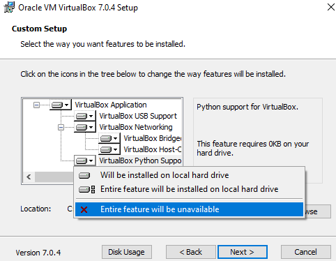

Voici l'apparence de la fenêtre après cette modification :

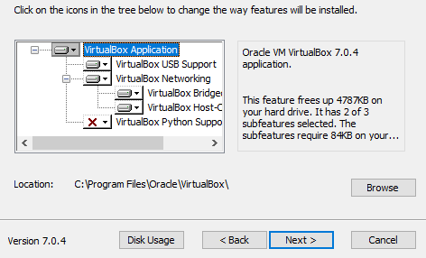

Vous pouvez conserver le support Python. C'est un composant facultatif qui permet d'automatiser des machines virtuelles avec VirtualBox, mais ce sujet sort du cadre du parcours. Nous souhaitons simplement éviter l'installation de composants inutiles.

Installez l'application sur le lecteur `C:` : elle a tendance à produire des erreurs ailleurs. La machine virtuelle pourra être stockée à un autre emplacement, comme nous le verrons bientôt. La barre de progression peut sembler bloquée ; attendez la fin de l'installation.

#### Étape 2.2 : créer une machine virtuelle

Ouvrez VirtualBox. Sur l'écran de démarrage, cliquez sur **Settings**, choisissez **Expert**, puis revenez à l'écran de démarrage.

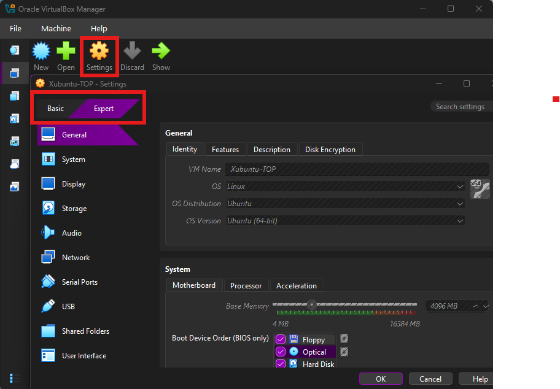

Cliquez sur **New** pour créer un système d'exploitation virtuel.

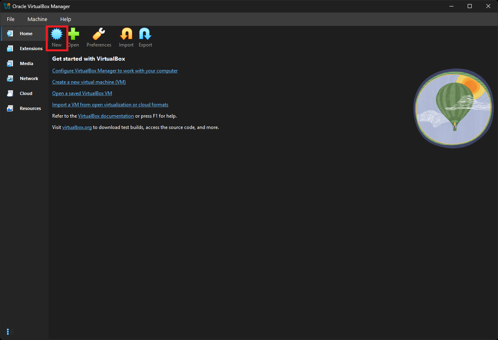

Nommez la VM **Xubuntu-TOP**. Pour l'installer ailleurs que dans l'emplacement `C:` par défaut, modifiez le champ **Folder**. C'est là que se trouvera le disque virtuel : prévoyez au moins 30 Go. Dans **ISO Image**, choisissez **Other**, puis sélectionnez sur votre ordinateur le fichier `.iso`, probablement dans le dossier `Downloads`.

**Décochez « Proceed with Unattended Installation ».** Cette option ne fonctionne pas et vous empêcherait de contrôler l'installation. Si vous l'activez par erreur, supprimez la VM avant l'installation et recommencez.

Les champs devraient se remplir automatiquement après la saisie du nom de la VM.

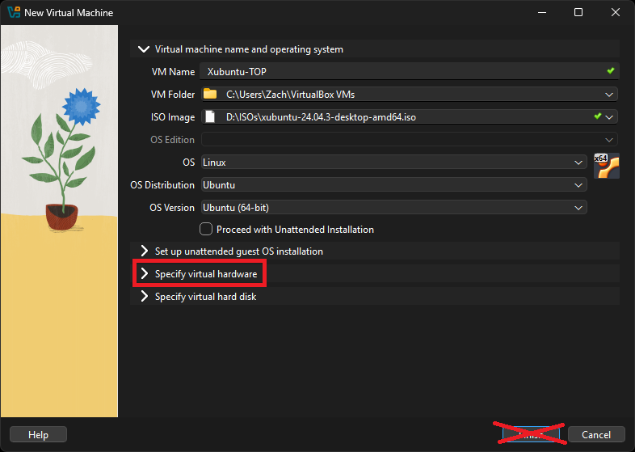

Ne cliquez pas encore sur **Finish**. Ouvrez l'accordéon **Specify virtual hardware** et suivez les étapes suivantes.

#### Étape 2.3 : définir le matériel virtuel

Vous devriez voir une fenêtre semblable à celle-ci :

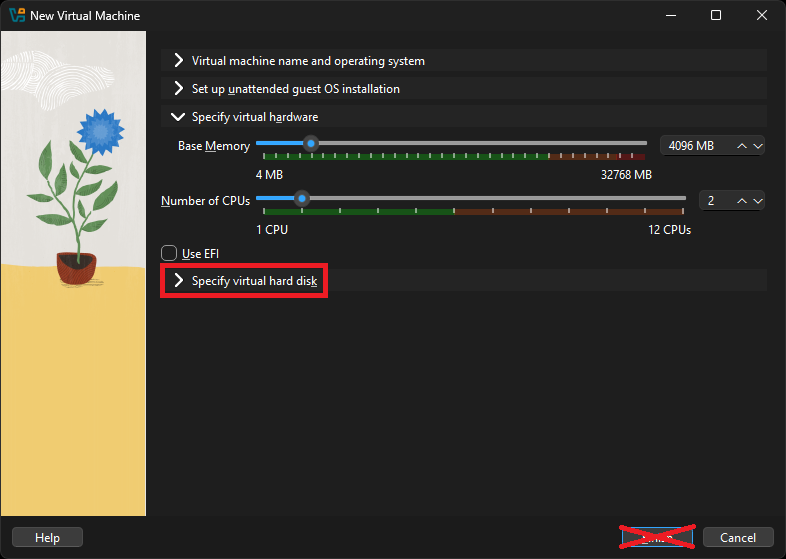

Dans la section **Hardware**, attribuez au moins 2048 Mo de **Base Memory**, davantage si possible. La limite supérieure est la moitié de la mémoire vive totale de votre ordinateur. Avec nos recommandations, 4096 Mo devraient offrir une expérience fluide.

> Par exemple, si votre ordinateur dispose de 8 Go (8192 Mo) de RAM, vous pouvez allouer jusqu'à 4096 Mo à la VM. Si vous ne savez pas combien de mémoire vive est disponible, vous pouvez rechercher comment le vérifier. Si la VM est lente, essayez de lui attribuer davantage de mémoire.

<div class="lesson-note lesson-note--tip" markdown="1">

#### Convertir les gigaoctets en mégaoctets

1 Go de RAM équivaut à 1024 Mo. Ainsi, **8 Go = 8 × 1024 = 8192 Mo**.

</div>

Réglez **Processors** sur 2, pas davantage, et laissez **Use EFI** décoché.

N'utilisez pas encore le bouton **Finish**. Ouvrez l'accordéon **Specify virtual hard disk**.

#### Étape 2.4 : définir le disque dur virtuel

Conservez les réglages par défaut, sauf **Disk Size** : nous recommandons au moins **30 Go**. Le disque sera créé dans le dossier choisi lors de la première étape, mais pourra être déplacé et agrandi ultérieurement si besoin.

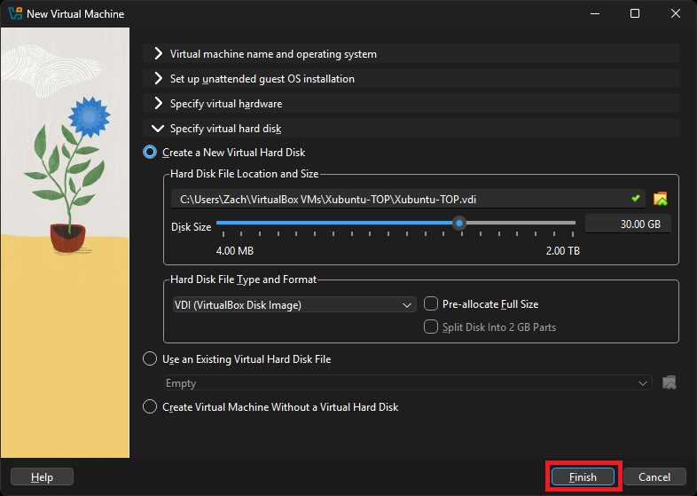

Cliquez maintenant sur **Finish**.

#### Étape 2.5 : mémoire vidéo virtuelle

Avant de lancer la VM, une dernière étape : cliquez sur **Settings**.

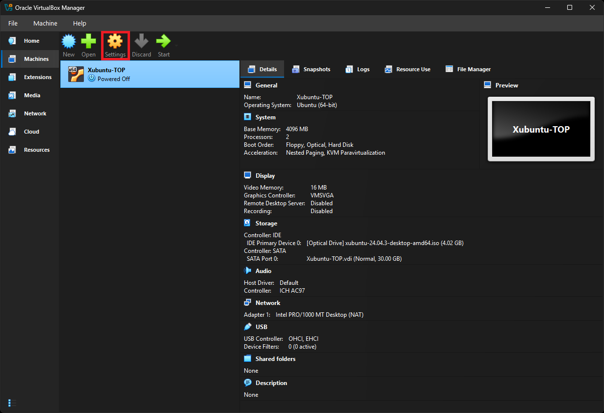

La page des paramètres de votre VM devrait ressembler à ceci :

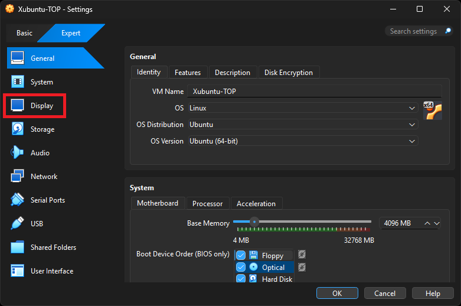

Cliquez sur **Display**. Activez **3D Acceleration** et réglez **Video Memory** au maximum. Si vous avez plusieurs écrans physiques, vous pouvez également augmenter le nombre d'écrans virtuels. Nous vous conseillons de le faire plus tard, lorsque vous serez à l'aise avec la VM.

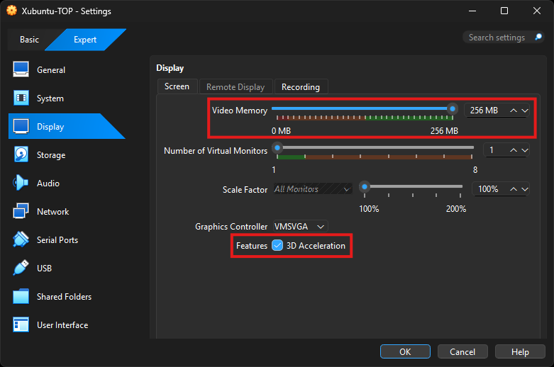

Cliquez sur **OK**. Vous pouvez maintenant commencer l'installation.

### Étape 3 : installer Xubuntu

De retour à l'écran d'accueil, sélectionnez la VM et cliquez sur **Start**. Si vous ouvrez par erreur le menu déroulant du bouton, choisissez **Start with GUI** ou cliquez de nouveau sur **Start**. Vous pouvez également double-cliquer sur la VM.

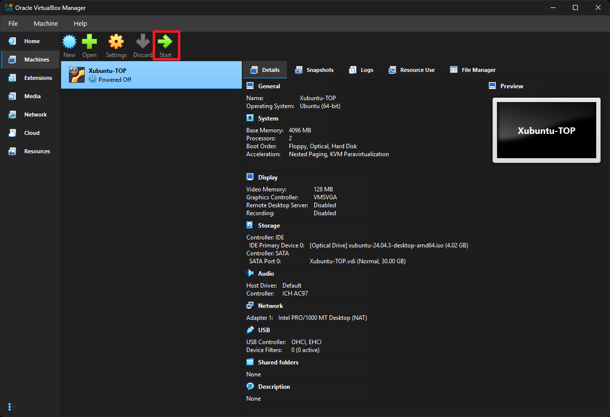

Une nouvelle fenêtre affichera le chargement de la machine virtuelle Oracle, puis le menu de démarrage GRUB de Xubuntu. Vous disposez généralement de 30 secondes pour choisir une option avec les flèches et confirmer avec Entrée. L'option sélectionnée par défaut convient ici : **Try or Install Xubuntu**. Si vous vous trompez, fermez la VM avec **File > Close**, ou le bouton X, puis choisissez **Power off the machine**.

L'écran sera petit pour le moment ; nous réglerons cela plus tard.

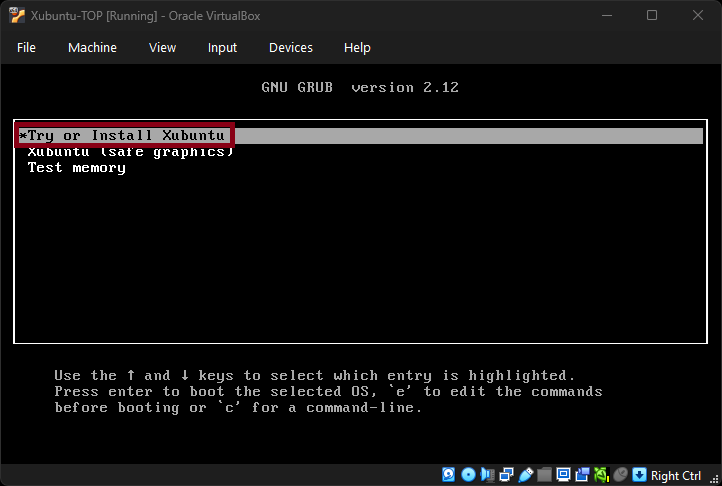

Du texte apparaîtra brièvement dans la console avant que le bureau Xubuntu ne s'affiche.

Il s'agit d'un environnement temporaire appelé bureau Live. À l'exception de l'installation du système dans la VM, les changements effectués ici ne sont pas permanents.

Double-cliquez sur l'icône du bureau **Install Xubuntu**.

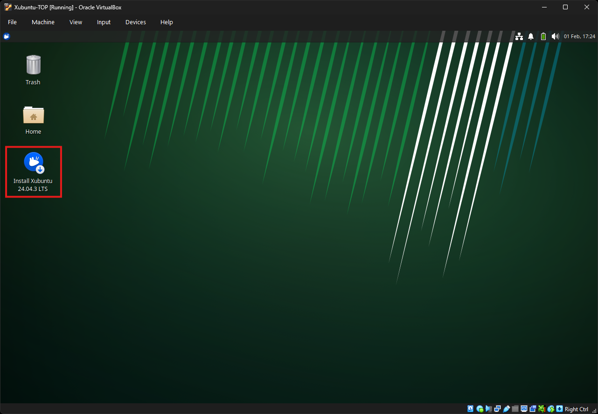

Dans la fenêtre *Welcome to Xubuntu*, choisissez votre langue et cliquez sur **Next**.

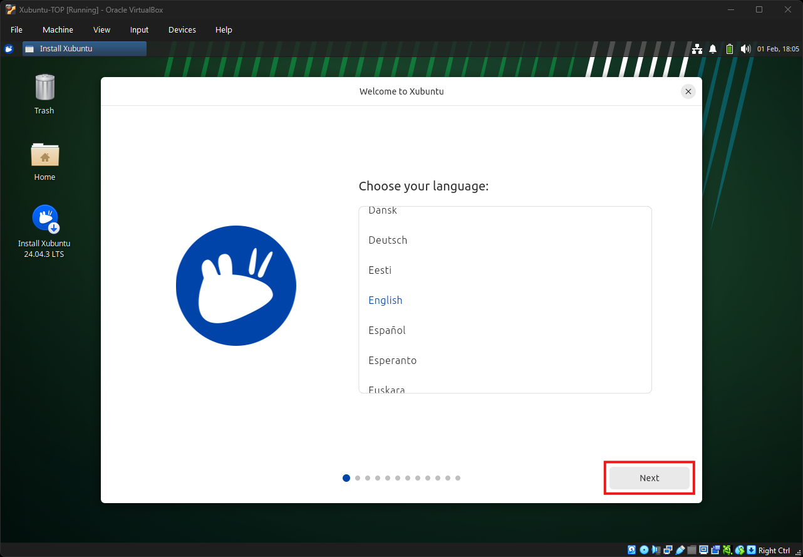

Sur l'écran *Select your keyboard layout*, vous pouvez saisir du texte dans le champ prévu pour vérifier votre disposition de clavier. Faites-le, puis cliquez sur **Next**.

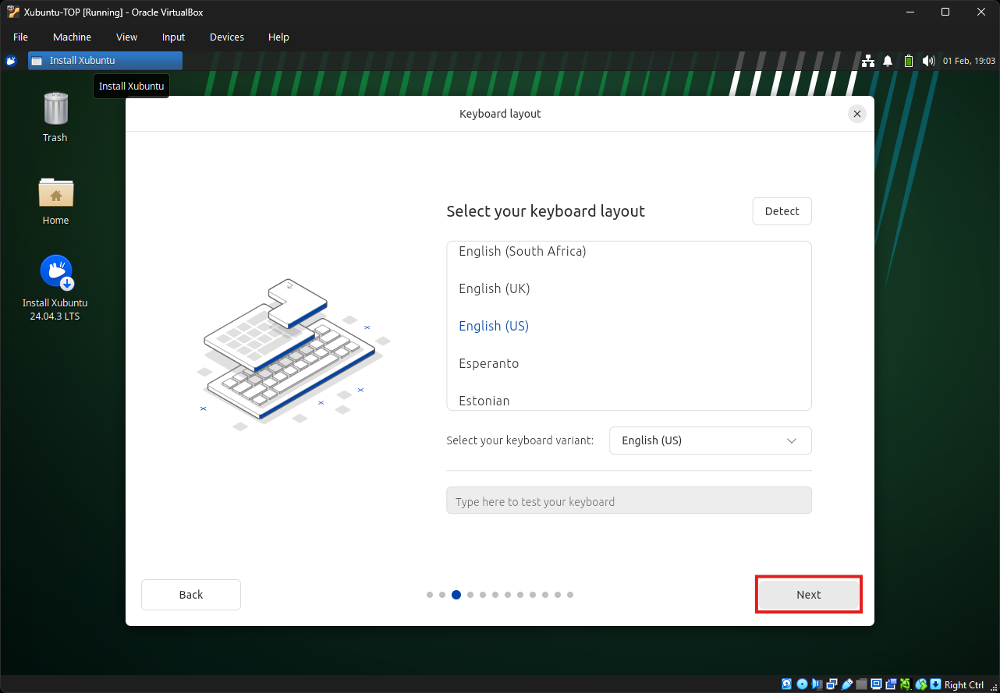

À l'écran de connexion à Internet, choisissez **Use wired connection** si cette option n'est pas déjà sélectionnée. VirtualBox utilise le périphérique réseau de l'ordinateur hôte : que votre connexion soit filaire ou sans fil, la VM se croit toujours reliée par câble.

Si vous ne pouvez pas choisir **Use wired connection**, relancez l'installateur VirtualBox et sélectionnez **repair**.

> **Utilisateurs de VPN** : si la VM ne semble pas pouvoir se connecter à Internet ou effectuer les mises à jour, pensez à l'ajouter aux exceptions du VPN, à utiliser un tunnel à séparation inversée ou à désactiver temporairement le VPN. Si le tunnel à séparation ne fonctionne pas, essayez de définir l'adaptateur réseau de la VM sur *Bridged Adapter*.

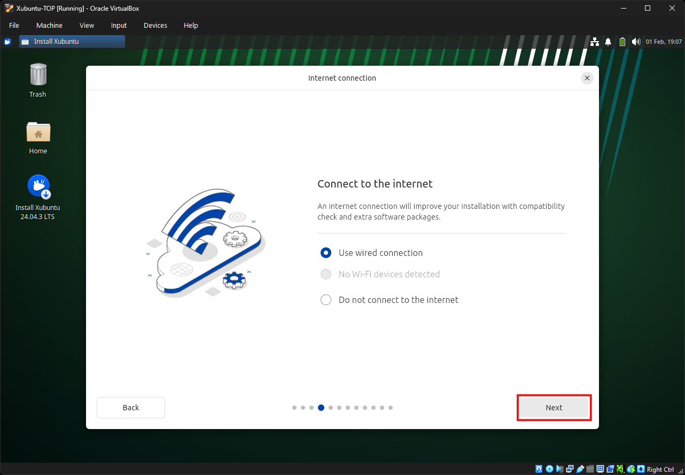

À la question *How would you like to install Xubuntu?*, gardez l'option par défaut **Interactive installation**. Nous n'avons pas de fichier de configuration et n'en avons pas besoin. Les installations automatisées servent plutôt aux professionnels de l'informatique qui configurent les postes des employés ou les systèmes d'un laboratoire personnel ; ce sujet est hors du cadre de ce parcours. Cliquez sur **Next**.

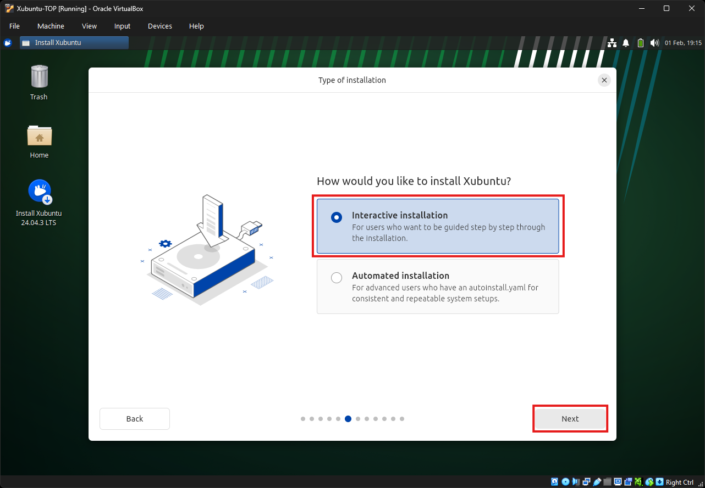

À la question *What apps would you like to install to start with?*, gardez également l'option par défaut, qui installe toutes les applications. Cette VM servira d'outil d'étude et doit être complète. Cliquez sur **Next**.

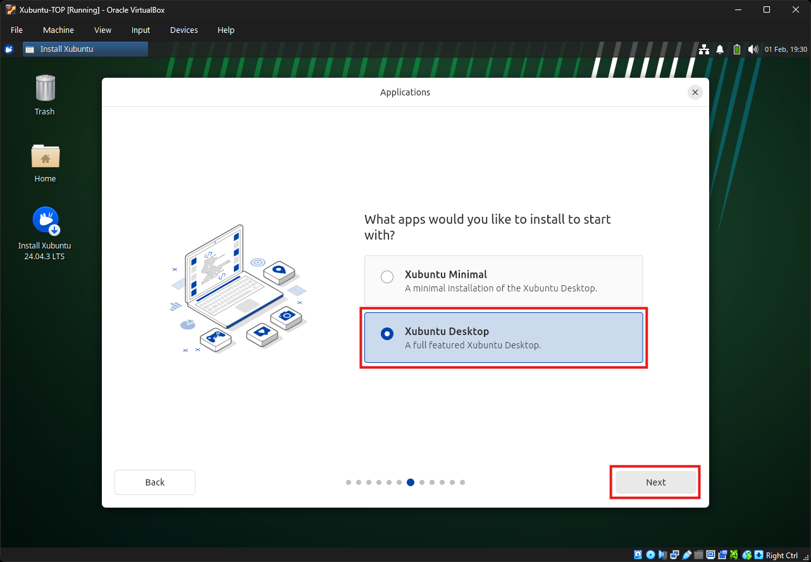

À la question *Install recommended proprietary software?*, répondez oui en cochant les deux cases, puis cliquez sur **Next**.

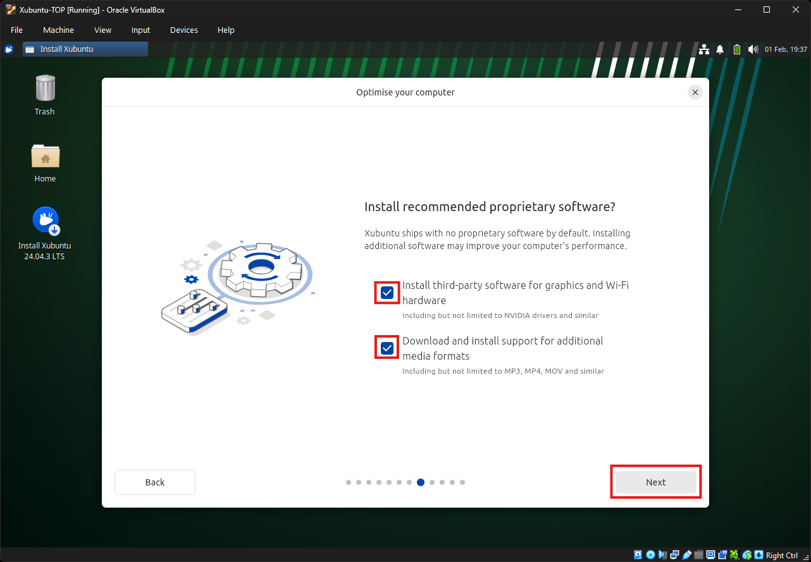

À la question *How do you want to install Xubuntu?*, sélectionnez l'option par défaut **Erase disk and install Xubuntu**. Cette action est sans danger : elle ne touche pas au disque physique de l'ordinateur hôte, car le disque est virtualisé. L'installation manuelle dépasse le cadre du parcours, mais vous pourrez l'étudier plus tard. Cliquez sur **Next**.

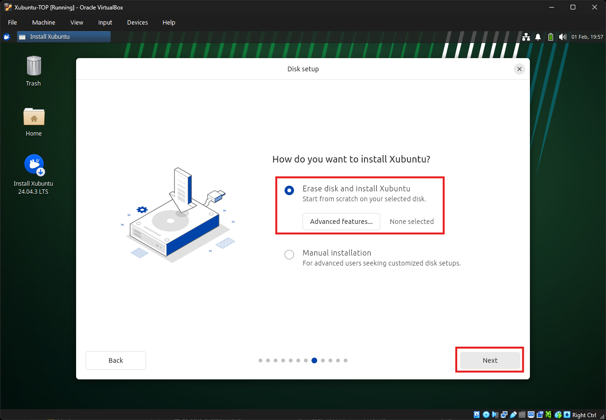

Sur l'écran *Create your account*, saisissez votre nom et un mot de passe. Le nom de l'ordinateur et le nom d'utilisateur sont générés automatiquement à partir du nom saisi, mais vous pouvez les modifier en utilisant des caractères valides. Choisissez un mot de passe dont vous vous souviendrez, car vous le saisirez souvent, puis cliquez sur **Next**.

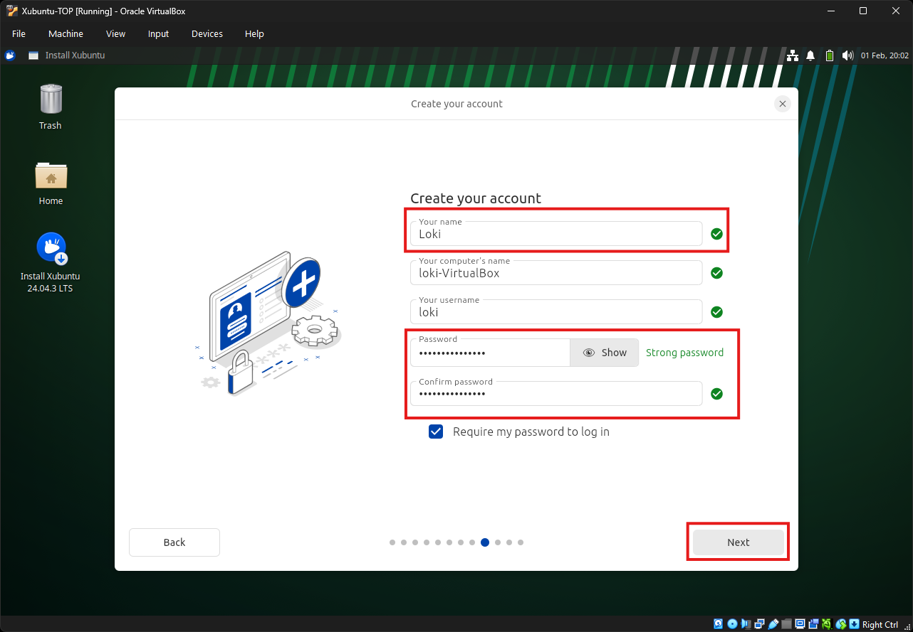

Choisissez votre fuseau horaire en saisissant un lieu ou un fuseau horaire, puis cliquez sur **Next**.

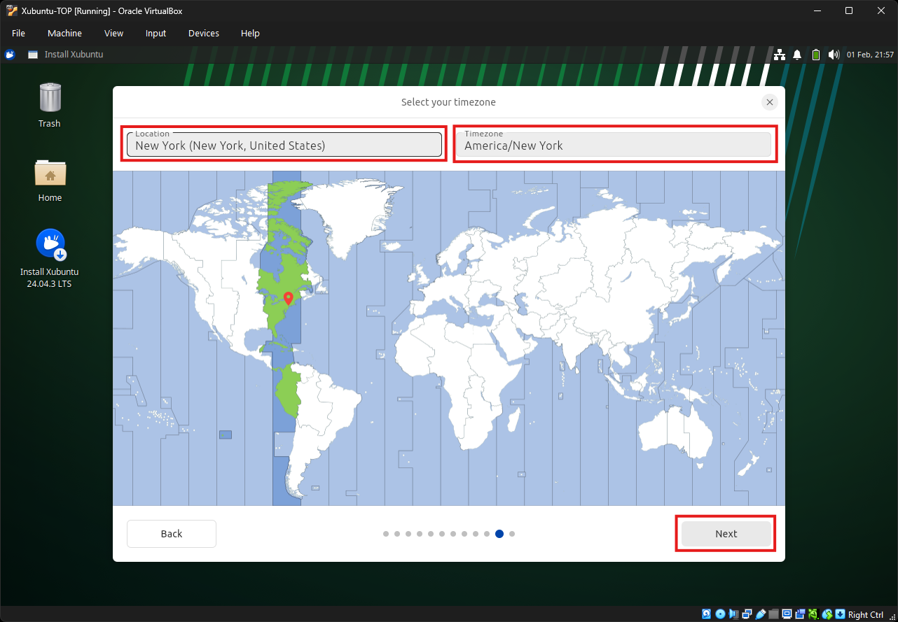

L'écran *Review your choices* récapitule vos choix. Lorsque vous êtes prêt à attendre un moment, cliquez sur **Install**.

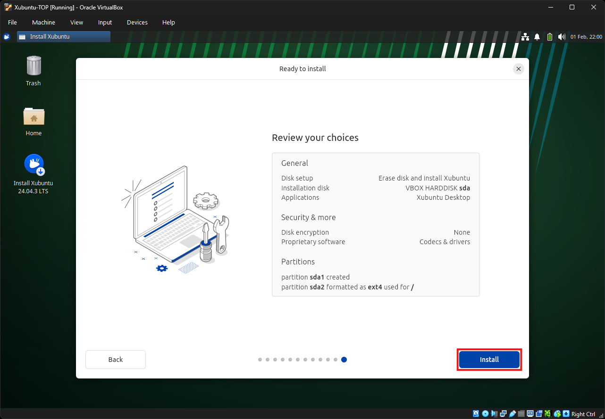

L'installation progresse automatiquement sur les écrans suivants. Il ne vous reste qu'à patienter.

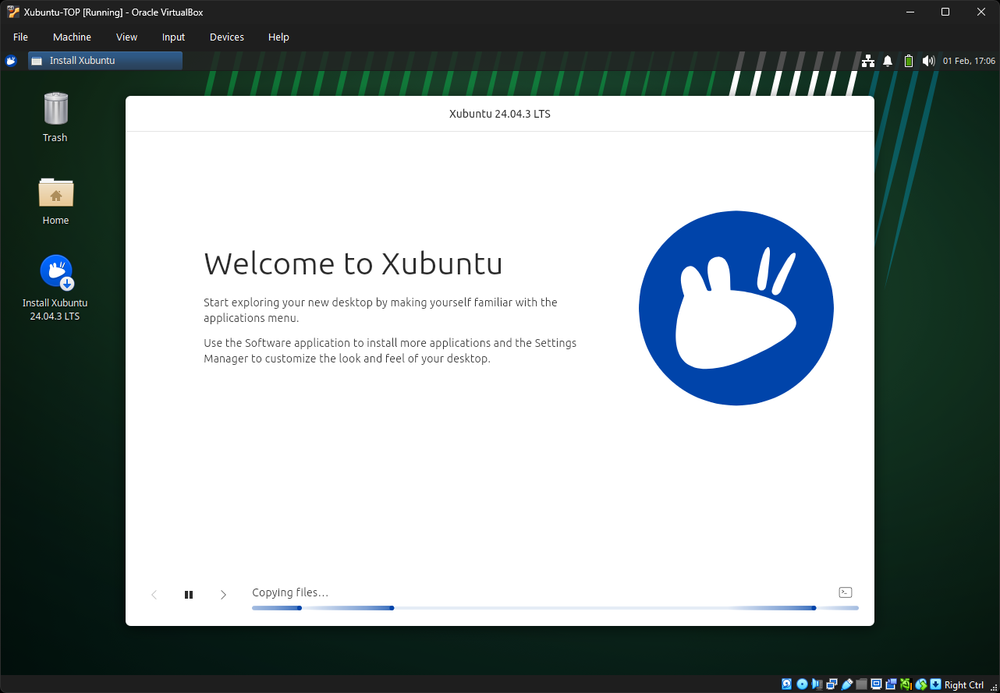

Une fois l'installation terminée, vous serez invité à quitter l'environnement Live et à démarrer Xubuntu dans la VM. Cliquez sur **Restart now**. Si vous avez choisi **Continue testing** et souhaitez reprendre, cliquez sur le , puis **Log Out** et **Restart**. Après le redémarrage, si un écran noir persiste, cliquez dans la fenêtre de la VM et appuyez sur <kbd>Entrée</kbd> : l'installateur attend peut-être que vous confirmiez le retrait du média d'installation. Si rien ne se passe, patientez. Si l'écran noir dure plus de dix minutes, fermez la VM et démarrez-la manuellement.

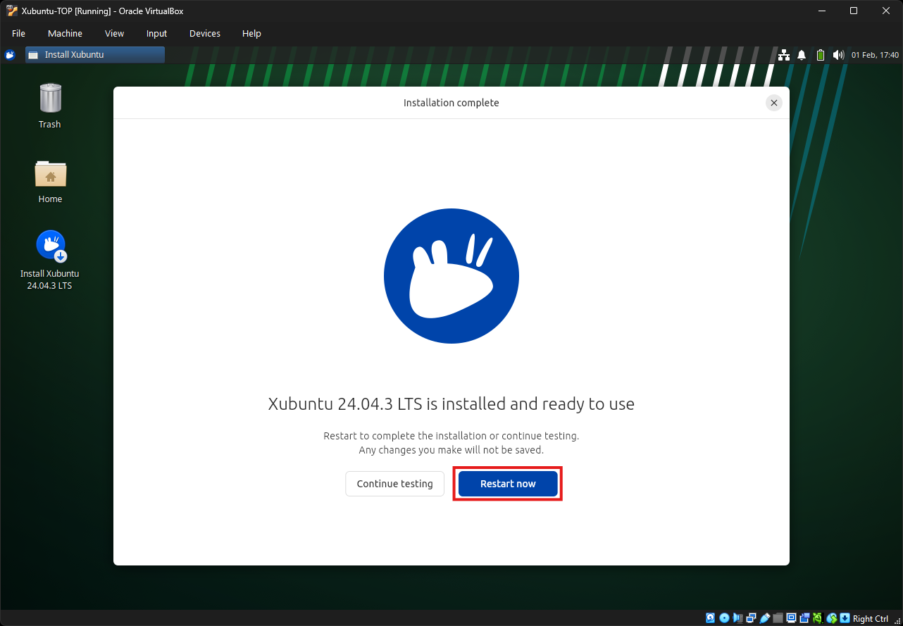

Au redémarrage, vous devriez voir l'écran de connexion. Saisissez votre mot de passe et cliquez sur **Log in**.

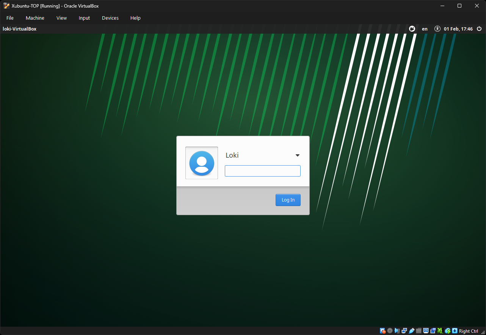

### Étape 4 : mises à jour et Additions invité

Avant d'utiliser votre VM, vous remarquerez peut-être des saccades, un peu de lenteur ou un affichage réduit. Il manque les pilotes qui permettent à Xubuntu de profiter du « matériel » virtuel. Les **Additions invité** de VirtualBox apportent ces pilotes. Commençons par mettre le système à jour.

Voici un raccourci pratique pour ouvrir l'un des outils les plus utiles de Linux : le terminal (ou terminal virtuel). Le terminal est en réalité virtuel même hors d'une VM, mais cette notion dépasse le cadre du parcours. Pour en savoir plus sur Linux, consultez gratuitement le livre [The Linux Command Line](https://linuxcommand.org/tlcl.php).

Appuyez sur <kbd>win</kbd> + <kbd>T</kbd> : une nouvelle fenêtre s'ouvre et vous invite à saisir des commandes. C'est le terminal. Vous pourrez en ouvrir plusieurs, mais pour l'instant, gardez-en un seul.

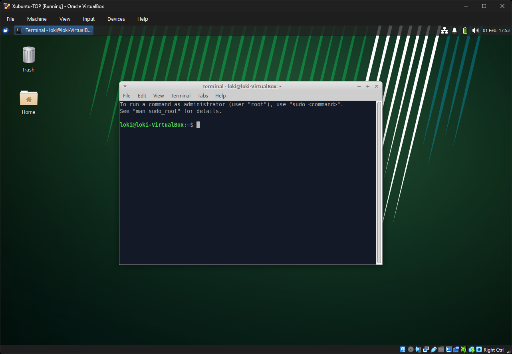

Nous allons effectuer les mises à jour en ligne de commande. Il existe une interface graphique, mais vous verrez ici comment exécuter des commandes dans une interface en ligne de commande (CLI) et suivre la progression dans le terminal.

Saisissez exactement les commandes suivantes et appuyez sur Entrée après chaque ligne. Pour l'instant, vous ne pourrez pas les copier-coller.

```bash
sudo apt update
```

La première commande vous demandera votre mot de passe. Lorsque vous le saisissez, le terminal n'affiche aucun caractère. Ce n'est pas un bogue, mais une mesure de sécurité : contrairement aux applications qui affichent des points, Linux empêche même les personnes à proximité de compter les caractères du mot de passe.

Saisissez le mot de passe et appuyez sur Entrée pour télécharger les mises à jour disponibles.

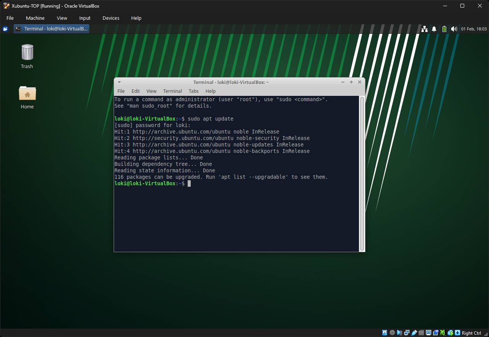

Quand le terminal affiche de nouveau l'invite de commande, l'opération est terminée. Il indique alors le nombre de paquets pouvant être mis à niveau.

La mise à jour seule ne suffit pas : il faut aussi mettre à niveau les paquets. Sur les systèmes dérivés d'Ubuntu, le processus se fait en deux étapes ; il peut varier sur d'autres systèmes.

Saisissez la commande suivante :

```bash
sudo apt upgrade
```

Après avoir affiché du texte, le terminal vous demandera si vous souhaitez continuer. Saisissez `Y` pour oui et appuyez sur Entrée. Vous remarquerez qu'il ne vous redemande pas votre mot de passe juste après la première commande `sudo` : un délai est accordé après une commande `sudo` réussie avant de vous le demander à nouveau. C'est une autre mesure de sécurité.

Cette étape peut prendre un moment.

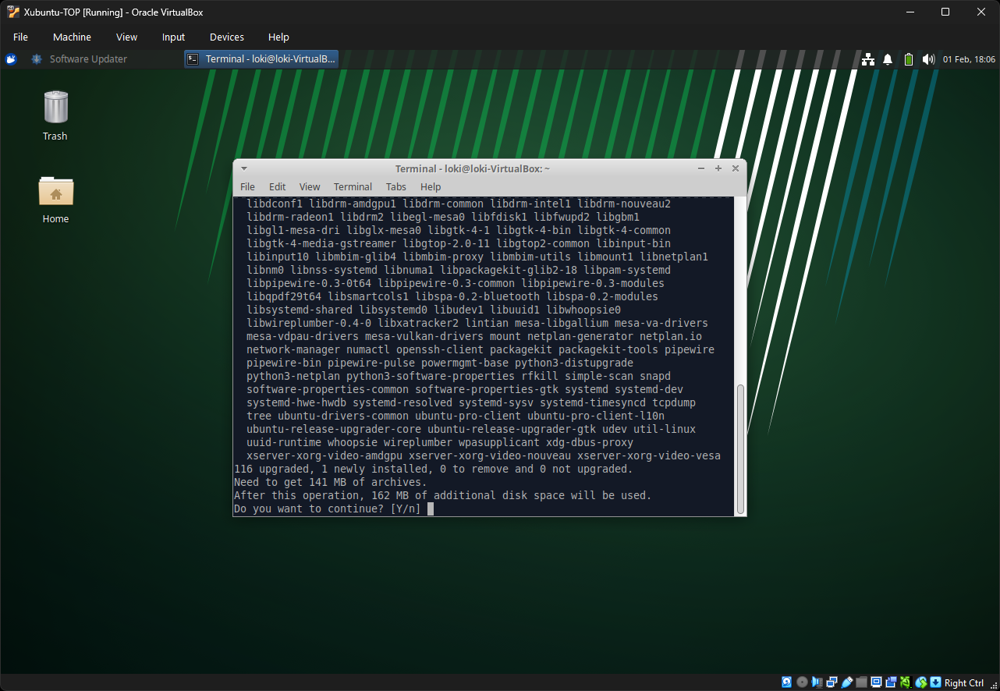

Une fois la mise à niveau terminée, installons les paquets nécessaires aux Additions invité :

```bash
sudo apt install build-essential dkms
```

Saisissez `Y` pour autoriser l'installation. Ce sont deux paquets distincts ; leur rôle dépasse le cadre du guide, mais vous pouvez vous renseigner à leur sujet.

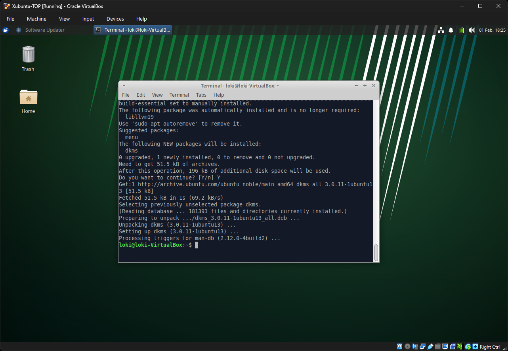

Dans la barre d'outils de la VM, cliquez sur **Devices**, puis tout en bas du menu sur **Insert Guest Additions CD image...**. Après quelques secondes, une notification indiquera que le CD est monté et un explorateur de fichiers affichera son contenu.


La façon la plus simple d'installer les Additions invité consiste à faire glisser le fichier `VBoxLinuxAdditions.run` dans le terminal. Commencez par nettoyer l'affichage avec `clear` et Entrée. Tapez ensuite `sudo` suivi d'un espace, sans appuyer sur Entrée. Dans l'explorateur, faites glisser le fichier `VBoxLinuxAdditions.run` jusque dans le terminal. Quand son chemin apparaît, cliquez sur le terminal pour lui redonner le focus.

Les trois images ci-dessous illustrent la procédure :

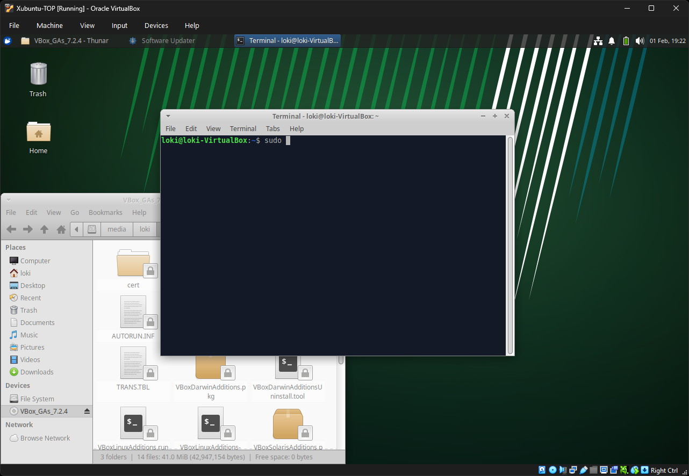

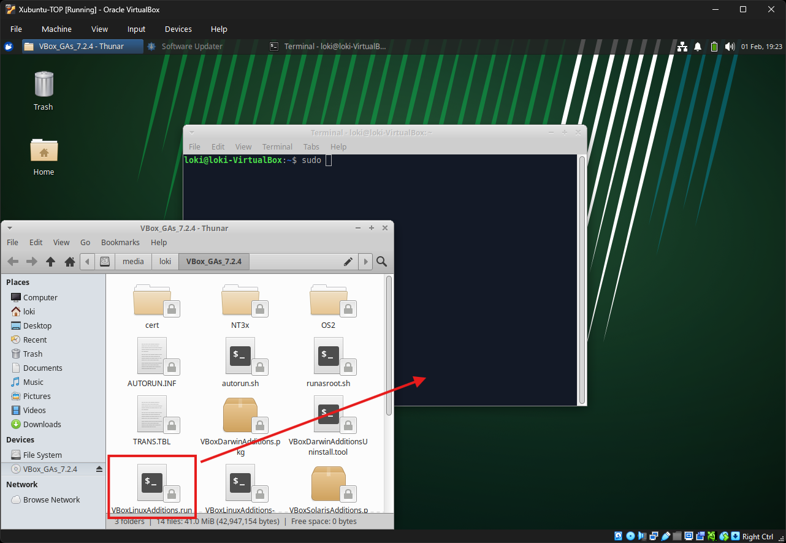

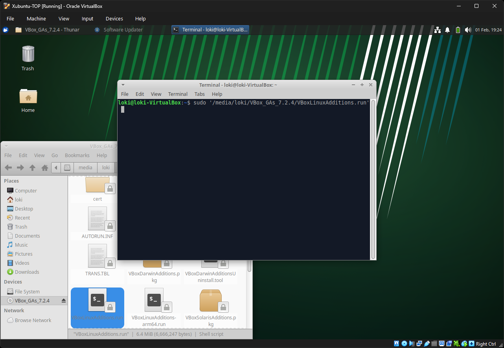

Appuyez sur Entrée dans le terminal et saisissez votre mot de passe si nécessaire. La taille de la fenêtre peut changer pendant l'installation. Redémarrez la VM avec le nouveau raccourci `sudo reboot` pour terminer l'installation des Additions invité.

Après la reconnexion, vous ne remarquerez peut-être rien de différent. Essayez d'agrandir la fenêtre de la VM : vous aurez beaucoup plus de place !

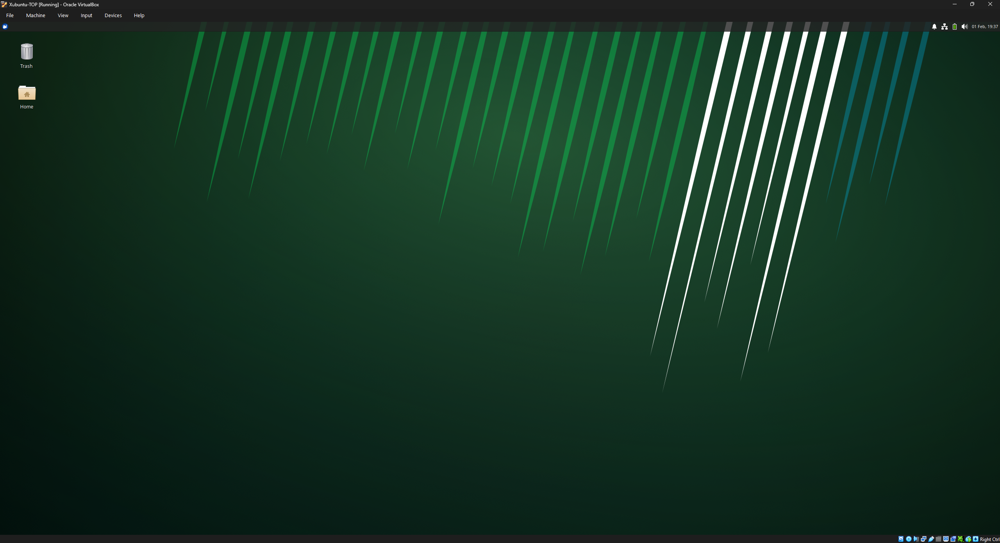

Les problèmes de performances devraient aussi être moins fréquents. Vous pouvez continuer le parcours. Pensez à éjecter l'image des Additions invité. Exécutez `sudo eject /dev/sr0` dans le terminal, ou cliquez sur le bouton d'éjection triangulaire à côté de l'image montée dans l'explorateur. Vous pouvez la laisser montée, mais il est plus propre de la retirer, car nous n'en avons plus besoin.

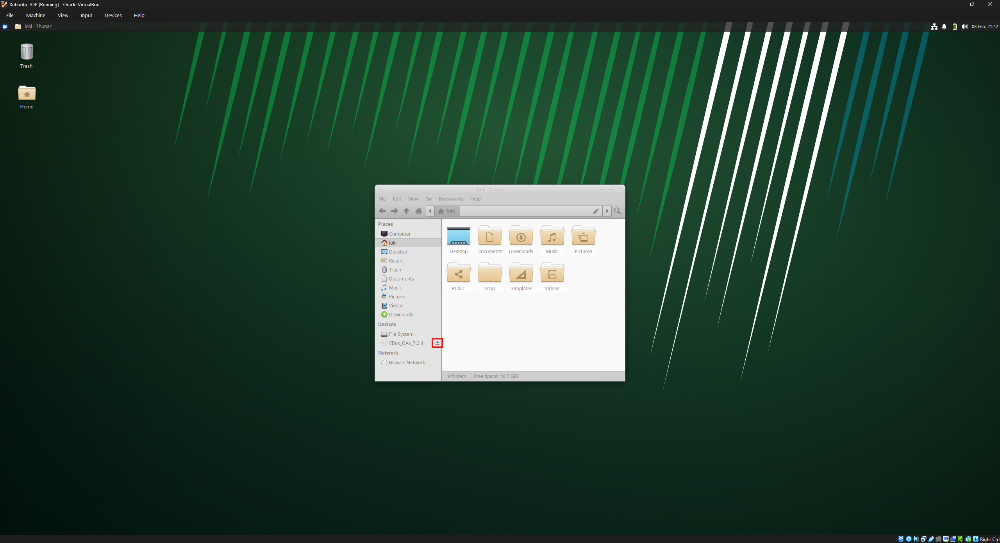

### Étape 5 : découvrir votre nouvelle VM

#### Étape 5.1 : ouvrir le site dans la VM

À partir de maintenant, consultez le site The Odin Project (TOP) dans la VM et suivez les instructions Linux. Le parcours vous demandera souvent de copier et coller du code entre la leçon, votre éditeur et le terminal. Cela ne fonctionne pas facilement si vous passez de la VM à Windows, car ce sont des environnements séparés.

**Pour la suite du parcours TOP, suivez les instructions Linux uniquement.**

Conseils pour commencer dans un environnement virtuel :

- Si la barre d'outils est masquée, activez-la dans les paramètres de la VM. Cliquez sur **Settings**, puis **User Interface**, et cochez **Show at Top of Screen**. Les options du plein écran et des écrans multiples pourront vous être utiles.
  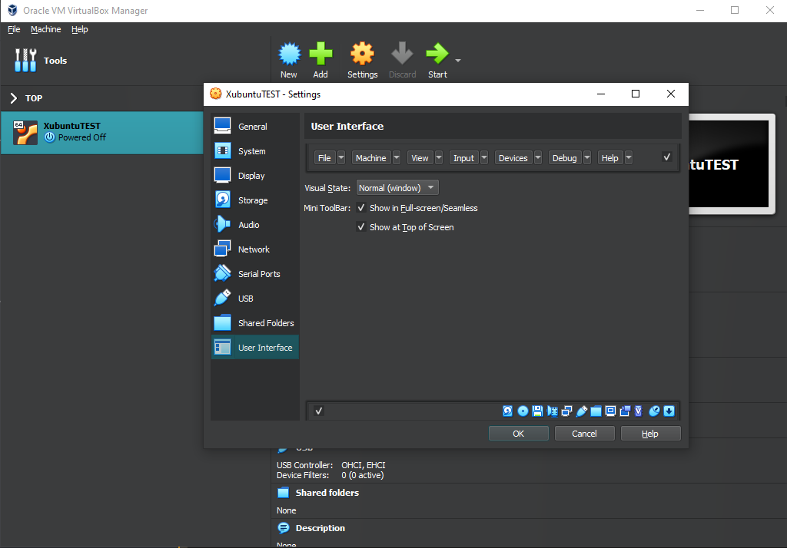
- Effectuez tout votre travail dans la VM. Installez-y tous les outils nécessaires au développement, notamment votre éditeur de texte, vos environnements de langage et les autres logiciels. Xubuntu inclut un navigateur Web, mais nous installerons bientôt Chrome.
- Activez le presse-papiers partagé : dans **Devices > Shared Clipboard**, choisissez **Bidirectional**. Vous pourrez alors copier-coller entre l'hôte et l'invité. Essayez de travailler entièrement dans la VM. Dans le terminal, le raccourci de collage est `ctrl+shift+v`.
- Pour installer des logiciels, suivez les instructions Linux (Ubuntu) depuis la VM Xubuntu.
- Vous pourriez avoir besoin de captures d'écran pour demander de l'aide sur Discord :
  - **Dans la VM** : utilisez <kbd>Shift</kbd> + <kbd>PrtSrc</kbd> pour capturer une portion de l'écran. Vous pouvez aussi ouvrir le **menu Whisker**, chercher **Screenshot** et choisir de capturer l'écran entier, la fenêtre active ou une zone.
  - **Sur l'hôte Windows** : utilisez la touche hôte (<kbd>Ctrl droit</kbd> + <kbd>E</kbd>) ou **View > Take Screenshot** pour capturer l'écran entier. Vous pouvez aussi désactiver le focus de la VM en cliquant à l'extérieur, puis utiliser <kbd>Windows</kbd> + <kbd>Shift</kbd> + <kbd>S</kbd> pour sélectionner une zone.
- **Rappel :** tout le développement lié à TOP doit se faire dans la VM.
- Nous recommandons le plein écran (**View > Full-screen Mode**) et de laisser de côté Windows. Pour de meilleures performances, fermez les programmes de l'hôte pendant l'utilisation de la VM.
- Pour ajouter des écrans, éteignez la VM, puis augmentez leur nombre dans l'onglet **Display** des paramètres VirtualBox. Dans la VM démarrée, cliquez sur **View > Virtual Screen 2 > Enable**. Il est possible d'utiliser plusieurs écrans en plein écran ; il faudra peut-être augmenter la **Video Memory**, comme indiqué précédemment. **Activez les écrans virtuels en mode fenêtré avant de passer en plein écran, sinon ils ne fonctionneront pas.** À la sortie du plein écran, l'écran secondaire peut se fermer ; vous pouvez le réactiver de la même façon.

#### Problèmes fréquents et questions

- **Écran noir au démarrage** : éteignez la VM, puis dans VirtualBox, ouvrez **Settings > Display**. Décochez **Enable 3D Acceleration** et vérifiez que la mémoire vidéo est d'**au moins 128 Mo**.
- **« Launch Error » mentionnant `ubuntu-desktop-bootstrap` au lancement de l'installation Xubuntu** : éteignez la VM, vérifiez dans **Settings > Display** que la mémoire vidéo est d'**au moins 128 Mo**, puis redémarrez la VM.
- **Grésillements audio** : éteignez la VM, puis dans **Settings > Audio**, choisissez **Intel HD Audio** comme **Audio Controller**.
- **Espace disque insuffisant ?** Consultez ces [instructions pour augmenter l'espace disque de la VM, publiées sur le Discord TOP](https://discord.com/channels/505093832157691914/690588860085960734/1015965403572351047).
- **Écran tactile ?** Regardez cette vidéo sur l'[activation des commandes tactiles dans VirtualBox](https://www.youtube.com/watch?v=hW-iyHHoDy4).

**Conseils de performance pour la VM :**

- Limitez l'activité dans Windows pendant que la VM fonctionne. Si vous utilisez un ordinateur portable, branchez-le à une prise secteur.
- Réglez le nombre de processeurs sur 2. Attribuez à la VM au plus la moitié de votre mémoire vive totale, et au moins 2 Go. Si vous ne pouvez pas lui consacrer 2 Go, envisagez un double démarrage.
- Si les vidéos saccadent, attribuez toute la mémoire vidéo disponible à la VM ou lisez-les dans Windows si votre ordinateur le permet. Désactivez l'accélération 3D si elle est activée.
- Regardez si l'icône  apparaît en bas à droite de la fenêtre. Elle indique que Hyper-V est activé. Un fil de discussion sur le forum VirtualBox explique [comment désactiver complètement Hyper-V](https://forums.virtualbox.org/viewtopic.php?f=25&t=99390). L'icône souhaitée est celle d'une puce avec un V : . Si aucune des deux icônes n'est visible, quittez le plein écran. La tortue apparaît sur toutes les captures d'écran utiles ci-dessus.
- Une installation WSL2 antérieure s'appuie sur Hyper-V ; désactiver Hyper-V seul ne suffira donc pas à améliorer la VM. Nous recommandons de désactiver complètement WSL2 pendant l'utilisation de la VM et de vérifier que Hyper-V est désactivé. L'article de [ninjaOne sur l'activation et la désactivation de WSL2 sous Windows 10](https://www.ninjaone.com/blog/enable-or-disable-windows-subsystem-for-linux-wsl/) indique où effectuer ce réglage.
- Si les performances restent insuffisantes, choisissez le double démarrage : un seul système d'exploitation utilisera alors toutes les ressources matérielles.
- Si la molette de défilement se comporte étrangement dans Chrome ou d'autres applications, après avoir vérifié le fonctionnement de la VM, vérifiez que la [version des Additions invité est correcte](https://discord.com/channels/505093832157691914/690588860085960734/1195697147123867668).

**Éteindre la VM en toute sécurité**

Vous ne débranchez pas votre ordinateur habituel pour l'éteindre ; faites de même avec la VM. En cliquant sur le X pour fermer directement la VM, vous risquez de perdre vos fichiers. Voici trois façons de l'arrêter correctement :

- **Option 1 — depuis l'interface de la VM** : ouvrez le **menu Whisker** , cliquez sur l'icône d'alimentation, puis sur **Shutting Down**. C'est au même endroit que l'option **Restart**.
- **Option 2 — depuis le terminal de la VM** : exécutez `poweroff`. Le système s'arrêtera immédiatement.
- **Option 3 — depuis l'interface VirtualBox** : dans le menu **File**, cliquez sur le bouton de fermeture (qui comporte également une icône d'alimentation). La fenêtre **Close Virtual Machine** propose **Save the machine state**, **Send the shutdown signal** ou **Power off the machine**.

  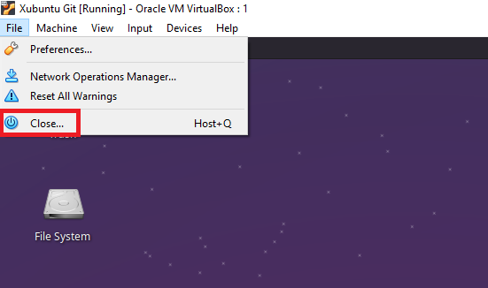

  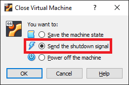

  Pour éteindre la VM sans risque de corrompre vos fichiers, choisissez **Send the shutdown signal**, puis cliquez sur **OK**.

[Retour à la leçon Installations](https://www.theodinproject.com/lessons/foundations-installations#os-installation)
