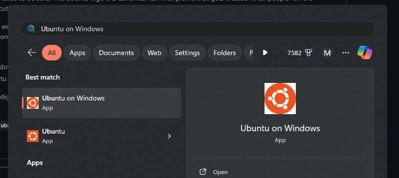
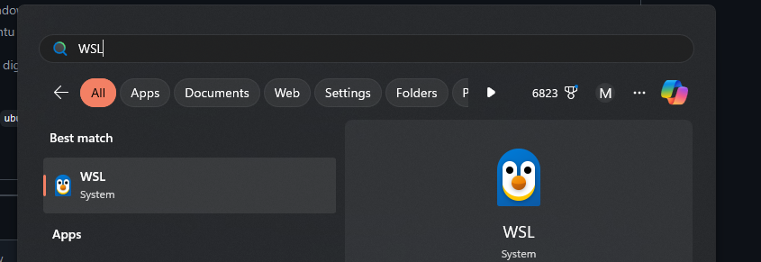

## Guide : configuration WSL2

Utiliser WSL2 est un moyen rapide et simple de commencer à utiliser Linux, en te permettant d'exécuter une distribution Linux depuis Windows. WSL2 est disponible sur Windows 10 version 2004 et ultérieure (Build 19041 et supérieur) ainsi que sur Windows 11.

Pour que ce soit clair : tu vas utiliser un autre système d'exploitation, ce n'est pas un moyen d'éviter Linux. En raison de la façon dont WSL2 est intégré à Windows, il provoque souvent une confusion importante chez les nouveaux apprenants. Utilise la machine virtuelle si tu veux une séparation claire entre Windows et Linux afin de suivre plus facilement le cursus.

:::note

### WSL2 et les instructions Linux

Comme WSL2 est une distribution Linux à part entière, presque tout ce que le cursus enseigne sur Linux s'applique aussi à WSL2. Dans les leçons à venir, chaque fois qu'il y aura des instructions qui diffèrent selon le système d'exploitation, tu devras suivre les instructions Linux, sauf si la leçon contient des instructions spécifiques à WSL2.

:::

## Étape 1 : installations

### Étape 1.1 : installer WSL2

1. Ouvre PowerShell en mode administrateur en le recherchant dans tes applications, en cliquant avec le bouton droit sur la première option, puis en sélectionnant « exécuter en tant qu'administrateur ». Une invite pourrait te demander si tu veux autoriser Windows Powershell à apporter des modifications à ton appareil : clique sur oui.
1. Saisis la commande suivante

   ```powershell
   wsl --install
   ```

1. Après quelques minutes, il te sera demandé de redémarrer ton ordinateur ; fais-le.
1. Tu devrais voir une fenêtre Powershell ouverte, te demandant de saisir un nom d'utilisateur et un mot de passe. Ton nom d'utilisateur doit être en minuscules, mais peut sinon être ce qui te convient. Tu devras aussi saisir un nouveau mot de passe.
1. Lorsque tu saisis ton mot de passe, tu pourrais remarquer que tu ne vois aucun retour visuel. Il s'agit d'une fonctionnalité de sécurité standard sous Linux, qui se produira aussi dans tous les futurs cas où tu devras saisir un mot de passe. Tape simplement ton mot de passe et appuie sur <kbd>Entrée</kbd>.

### Étape 1.2.1 : installer Windows Terminal (Windows 10 uniquement)

Windows Terminal est une application de terminal qui te permet de personnaliser et d'exécuter plus facilement des terminaux, et qui prend en charge plusieurs onglets pouvant chacun exécuter leurs propres terminaux différents. [Installe Windows Terminal](https://learn.microsoft.com/en-us/windows/terminal/install) en utilisant l'option d'installation directe.

### Étape 1.2.2 : définir WSL2 par défaut (facultatif)

Sauf si tu utilises régulièrement d'autres terminaux sur ton ordinateur, nous te recommandons de définir WSL2 comme programme de terminal par défaut lorsque tu ouvres Windows Terminal.

1. Ouvre Windows Terminal en recherchant terminal dans tes applications.
1. Clique sur la liste déroulante à côté du bouton de nouvel onglet (en haut de la fenêtre), puis sélectionne Paramètres.
1. Tu devrais voir une option Profil par défaut avec une liste déroulante à côté.
1. Dans la liste déroulante, sélectionne Ubuntu.
1. Clique sur enregistrer en bas de la page.

## Étape 2 : ouvrir WSL2

Sous Windows, il existe trois façons principales d'ouvrir WSL2.

- Si tu as configuré Windows Terminal pour ouvrir un terminal Ubuntu par défaut, tu peux démarrer une nouvelle session WSL2 en ouvrant l'application terminal.
- Tu peux ouvrir Windows Terminal, cliquer sur la liste déroulante à côté du bouton de nouvel onglet (en haut de la fenêtre), et sélectionner Ubuntu.
- Si tu recherches Ubuntu dans la barre de recherche d'applications, tu devrais voir une application intitulée Ubuntu ; ouvre-la pour démarrer une nouvelle session de terminal.

Toutes les options ci-dessous sont des sélections valides qui ouvriront le même programme :





:::tip

### Schéma de couleurs du terminal

Tu pourrais remarquer que lorsque tu ouvres WSL2 via Windows Terminal, tu vois une fenêtre avec un schéma de couleurs différent et une icône différente par rapport à l'ouverture d'un terminal via Ubuntu dans tes applications. C'est parce que Windows Terminal est livré avec un schéma de couleurs par défaut pour Ubuntu, destiné à imiter l'apparence d'un vrai terminal Ubuntu. Cette différence est purement cosmétique, et il n'y a aucune différence pratique entre les deux.

:::

:::warning

### /mnt/c n'est pas Linux !

Lorsque tu ouvres ton terminal WSL2, assure-toi de ne pas voir `/mnt/c` au début de la ligne. `/mnt/c` est l'endroit où vit ton installation Windows lorsque tu travailles dans WSL2, et y manipuler des choses peut avoir des conséquences inattendues.

:::

[Retour à la leçon Installations](https://www.theodinproject.com/lessons/foundations-installations#os-installation)
